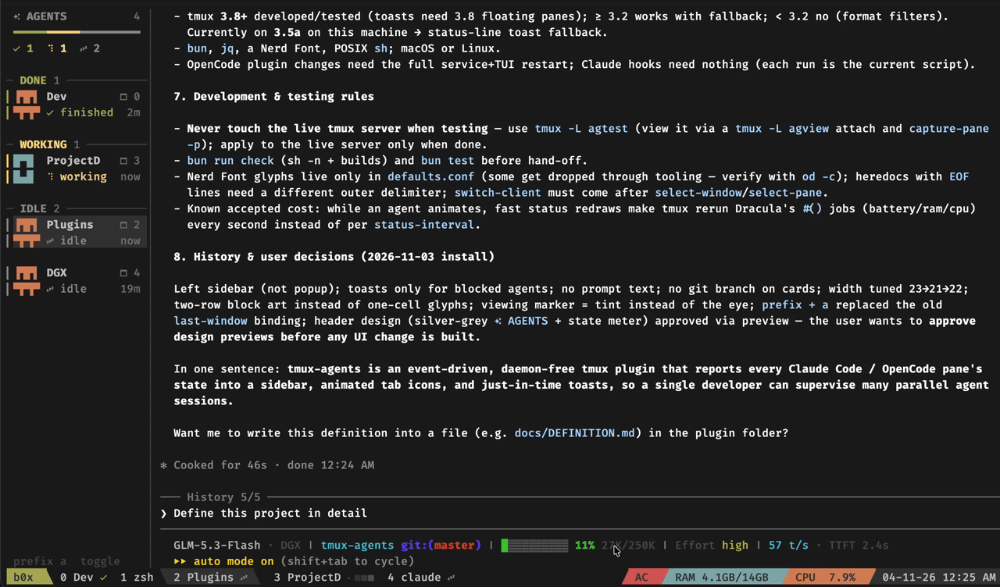
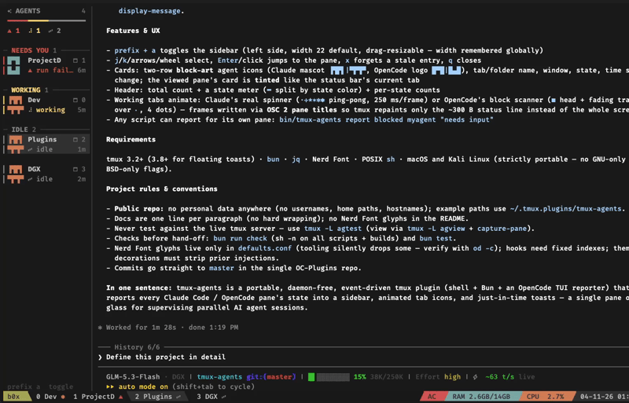

# Tmux Agents (tmux Plugin)

[](https://github.com/ellerbrock/open-source-badge/) [](LICENSE) [](https://github.com/d3vilbug/tmux-agents) [](https://github.com/tmux/tmux) [](#tested-on) [](https://claude.com/claude-code) [](https://opencode.ai)

Keep track of every Claude Code, Codex and OpenCode agent from one tmux sidebar: which one is working, which one needs you, and which one is done.



### Requirements
- tmux 3.2+ (3.8+ recommended for floating toasts; older versions show a status-line message instead)
- [bun](https://bun.sh) (sidebar renderer)
- [jq](https://jqlang.github.io/jq/) (Claude Code and Codex hook input, installer)
- A [Nerd Font](https://www.nerdfonts.com) in your terminal, e.g. FiraCode Nerd Font Mono (or [plain icons](#configuration))
- Claude Code, Codex (hooks, 0.166 or newer) and/or OpenCode V2

```bash
# macOS
$ brew install tmux bun jq

# Debian / Kali
$ sudo apt install tmux jq
$ curl -fsSL https://bun.sh/install | bash
```

### Tested On
- macOS
- Kali Linux
- tmux 3.8

### How to Install
```bash
$ git clone https://github.com/d3vilbug/tmux-agents ~/.tmux/plugins/tmux-agents
$ cd ~/.tmux/plugins/tmux-agents
$ ./install.sh --dry-run     # preview every change as a diff
$ ./install.sh
```

Press `prefix + a` to open the sidebar, then start `claude`, `codex` or `opencode` in any pane.

```bash
$ ./install.sh --help
tmux-agents installer. Safe to run again: every step checks first, and each
config file it changes is backed up to <file>.bak-<timestamp>.

  ./install.sh                 install everything that applies
  ./install.sh --uninstall     undo it
  ./install.sh --dry-run       show what would change (diffs), change nothing
  options: --no-tmux --no-claude --no-opencode --no-codex

Steps:
  tmux      append `run-shell .../tmux-agents.tmux` to the end of tmux.conf
            and load it into a running tmux server
  claude    merge the hooks into ~/.claude/settings.json (if Claude Code is installed)
  codex     merge the hooks into ~/.codex/hooks.json and enable them in
            ~/.codex/config.toml (if Codex is installed)
  opencode  add the plugin to ~/.config/opencode/cli.json (if OpenCode is installed)
```

Notes:
- New Claude sessions pick up the hooks. Sessions that were already running show up after their next prompt.
- Codex reads its hooks when a session starts, then asks you to trust the new hooks once: choose "Trust all and continue". Restart Codex sessions that were already running.
- OpenCode needs one full restart: close every TUI, run `opencode service restart`, reopen.
- The installer keeps your other hooks and plugins, and warns about entries that point to another copy of tmux-agents (they would report every event twice).
- It warns when `prefix + a` (or your `@agents-key`) is already bound to something else, e.g. `bind a last-window`. tmux-agents loads last and overrides it; to keep yours, set another key with `set -g @agents-key <key>` above the `run-shell` line.

#### Manual Install

**1. tmux**: add this line at the **end** of `~/.tmux.conf`, after your theme and the TPM `run` line, then `tmux source ~/.tmux.conf`:

```tmux
run-shell ~/.tmux/plugins/tmux-agents/tmux-agents.tmux
```

**2. Claude Code**: in `~/.claude/settings.json`, add this entry under each of these seven events in `hooks`: `SessionStart`, `UserPromptSubmit`, `PreToolUse`, `PostToolUse`, `Notification`, `Stop`, `SessionEnd`. Keep your existing hooks next to it.

```json
{ "hooks": [{ "type": "command", "timeout": 5,
  "command": "'/path/to/tmux-agents/bin/tmux-agents' claude-hook" }] }
```

**3. Codex**: in `~/.codex/hooks.json`, add the entry below under each of these ten events in `hooks`: `SessionStart`, `UserPromptSubmit`, `PreToolUse`, `PostToolUse`, `PermissionRequest`, `PreModelRequest`, `PostModelRequest`, `Stop`, `Interrupt`, `SessionEnd`. Use `"timeout": 3` for `Interrupt` and `SessionEnd` (Codex clamps them to 3 seconds), `5` for the others. Then enable hooks in `~/.codex/config.toml` with `hooks = true` under `[features]`, and restart Codex.

```json
{ "hooks": [{ "type": "command", "timeout": 5,
  "command": "'/path/to/tmux-agents/bin/tmux-agents' codex-hook" }] }
```

**4. OpenCode (V2)**: add the `opencode/` folder (absolute path) to the `plugins` array in `~/.config/opencode/cli.json`, then do the full OpenCode restart:

```json
{ "plugins": ["/path/to/tmux-agents/opencode"] }
```

### Tmux Agents Features
- **Agents sidebar** (`prefix + a`): every pane running an agent, grouped by state. It follows you across windows and sessions. Enter or a click jumps to the pane.
- **Tab state icons**: each window tab shows the most urgent state of its agents. Working tabs animate like the agent's own spinner.
- **Toasts**: a short floating notice in the top-right corner when an agent you are not looking at needs input (or finishes, if you want).
- **Unseen tracking**: *done* turns into *idle* once you have looked at the pane.
- **No daemon, no state files**: all state lives in tmux pane and window options.
- **Any agent**: other tools can report their state with one command.

| State | Sidebar | Meaning |
|---|---|---|
| `blocked` | NEEDS YOU | waiting on a permission prompt or a question |
| `done` | DONE | finished a turn you have not looked at yet |
| `working` | WORKING | running |
| `idle` | IDLE | waiting for a prompt |

### Keybindings
```
prefix + a          toggle the sidebar

In the sidebar:
  j / k, arrows     move the selection (mouse wheel works too)
  Enter, click      jump to the agent's pane
  x                 forget the selected entry
  q                 close the sidebar
```



### Command Cheatsheet

```bash
# Preview / install / uninstall
$ ./install.sh --dry-run
$ ./install.sh
$ ./install.sh --uninstall

# Install only some parts
$ ./install.sh --no-opencode
$ ./install.sh --no-claude --no-codex --no-opencode      # tmux only

# Update
$ cd ~/.tmux/plugins/tmux-agents && git pull && tmux source ~/.tmux.conf

# Report the state of any other agent or script (run inside a tmux pane)
$ TA=~/.tmux/plugins/tmux-agents/bin/tmux-agents
$ $TA report working myagent
$ $TA report blocked myagent "needs approval"
$ $TA report done myagent
$ $TA clear
```

After an update, press `prefix + a` twice to restart an open sidebar on the new code. Running Claude Code and Codex sessions keep their old hooks until restarted, and OpenCode needs the full restart again after a plugin change.

### Uninstall
```bash
$ cd ~/.tmux/plugins/tmux-agents
$ ./install.sh --uninstall --dry-run     # preview
$ ./install.sh --uninstall
$ rm -rf ~/.tmux/plugins/tmux-agents
```

This removes the `run-shell` line, the tmux key and hooks, the open sidebar and its state, the Claude Code and Codex hooks and the OpenCode plugin (each file is backed up first). `[features] hooks = true` stays in `~/.codex/config.toml`, since your own hooks may need it. Restart running agent sessions before deleting the folder, and do the full OpenCode restart.

### Configuration

Set options in `~/.tmux.conf` **above** the `run-shell` line, then `tmux source ~/.tmux.conf`. All options and their defaults are in [`defaults.conf`](defaults.conf).

```tmux
set -g @agents-key a                    # prefix + <key> toggles the sidebar
set -g @agents-sidebar-width 22         # a width you drag the sidebar to is remembered
set -g @agents-notify toast             # toast | off
set -g @agents-notify-on "blocked"      # states that notify: any of "blocked done"
set -g @agents-toast-seconds 2.5
set -g @agents-show-viewing tint        # mark the pane you look at: tint | eye | off

# Colors and icons per state (blocked, done, working, idle)
set -g @agents-color-blocked "#cc6666"
set -g @agents-icon-done "+"            # plain icons if you have no Nerd Font

run-shell ~/.tmux/plugins/tmux-agents/tmux-agents.tmux
```

### Troubleshooting
| Symptom | Fix |
|---|---|
| Icons are boxes or `?` | No Nerd Font. Switch the terminal font, or set plain icons (`@agents-icon-*`). |
| No icons on tabs | The `run-shell` line runs before your theme. Move it to the end of `~/.tmux.conf`. |
| A Claude pane is missing | The session started before the hooks were installed: send it a prompt. Check that `jq` is on `PATH`. |
| A Codex pane is missing | Restart Codex and choose "Trust all and continue" when it asks about the new hooks. Check `[features] hooks = true` in `~/.codex/config.toml` and that `jq` is on `PATH`. |
| An OpenCode pane is missing | Check the absolute path in `cli.json`, then do the full restart. `/plugins` in the TUI lists it. |
| No toast | You were looking at that pane, or the state is not in `@agents-notify-on`, or `@agents-notify` is `off`. |
| Card stuck at *working* after Esc | Claude Code has no hook for Esc. It turns idle after 60 s of waiting for input, or on the next prompt. |
| Every event shows up twice | Two copies are configured. `./install.sh --dry-run` lists the entries of the other copy. |

### How It Works
```
Claude Code ── hooks ──────┐
Codex ──────── hooks ──────┼──▶ tmux-agents report ──▶ tmux pane options (@agent_state …)
OpenCode ──── TUI plugin ──┘                               │
                                                           ├──▶ sidebar (bun)
                                                           ├──▶ tab icons (window format)
                                                           └──▶ toasts (floating pane)
```

- Each agent reports its own pane (`$TMUX_PANE`) with `tmux set`. tmux is the state store.
- Agents that exit without a final hook are cleaned up by `tmux-agents sweep` (tmux hooks and the status line).
- The icons are added to your theme's `window-status*-format` and `status-right`, and re-sourcing never duplicates them.

### Disclaimer
```
- The Claude Code and Codex hooks read only the event name, tool name, notification type and Codex's request status. Your prompts and the agents' output are never read.
- Everything runs locally. Nothing is sent anywhere.
- The installer only changes ~/.tmux.conf, ~/.claude/settings.json, ~/.codex/hooks.json, ~/.codex/config.toml and ~/.config/opencode/cli.json, and backs each one up first.
```

### License

This project is licensed under the [MIT License](LICENSE).

Copyright (c) 2026 d3vil bug

### Contribution

Issues and pull requests are welcome. Never test against your live tmux server; use a private one:

```bash
$ tmux -L agtest -f /dev/null new -d
$ tmux -L agtest run-shell "$PWD/tmux-agents.tmux"
$ TMUX= tmux -L agtest attach          # from another terminal

$ bun run check     # shell syntax + build of the sidebar and the OpenCode plugin
$ bun test          # OpenCode reporter and installer tests (private tmux servers)
```

Design rules and gotchas are in [`CLAUDE.md`](CLAUDE.md).

### Greets
- [herdr](https://github.com/herdrdev/herdr) for the idea of an Agents sidebar and its agent state reporting design
